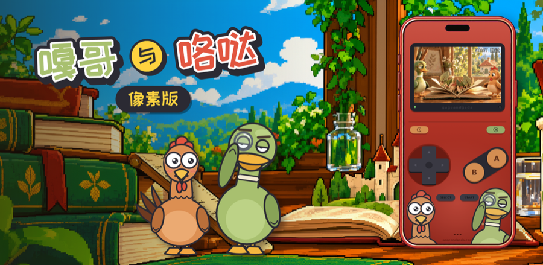
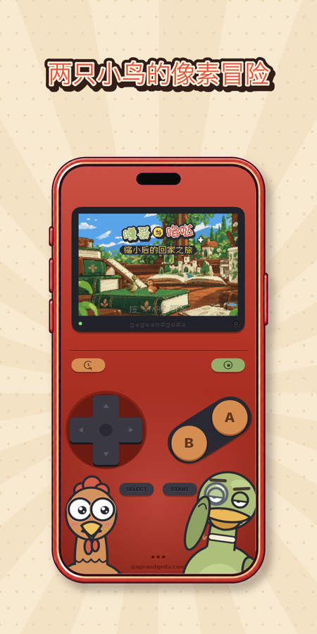
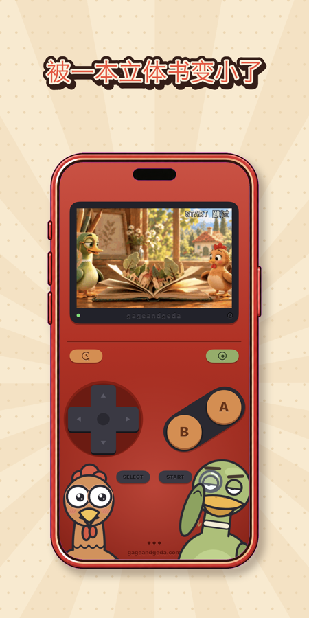
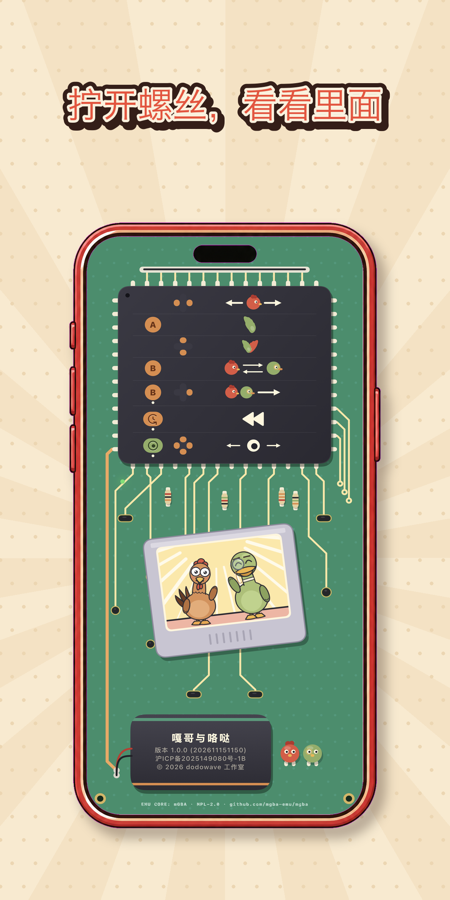
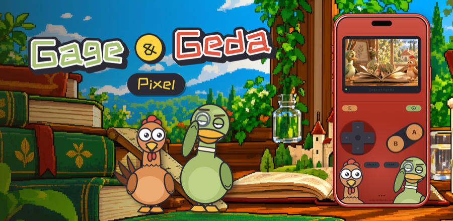
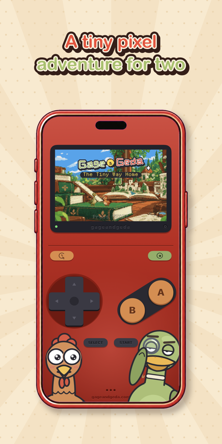
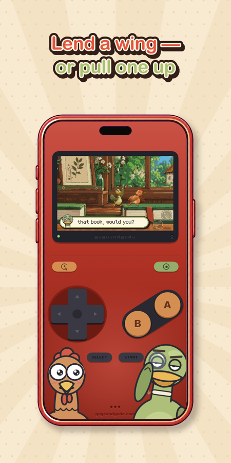
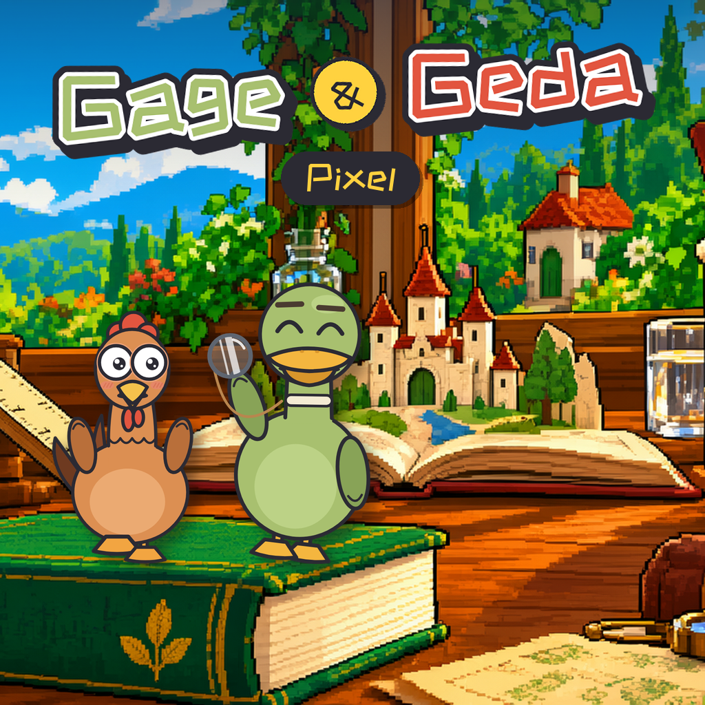

<h1 align="center">嘎哥与咯哒 像素版 · Gage &amp; Geda Pixel</h1>

<b>免费 · 无广告 · 无内购</b> &nbsp;|&nbsp; <b>Free · No ads · No in-app purchases</b> 
<a href="https://igerry.github.io/gage-geda-pixel/?lang=zh">中文下载页</a> · <a href="https://igerry.github.io/gage-geda-pixel/?lang=en">English download page</a> · <a href="https://github.com/igerry/gage-geda-pixel/releases/latest/download/GageAndGedaPixel.apk"><b>⬇ Android APK (37 MB)</b></a> · <a href="https://github.com/igerry/gage-geda-pixel/releases/latest/download/GageAndGeda-Pixel.gba"><b>⬇ GBA ROM (21 MB)</b></a>

[中文](#中文) · [English](#english)

---

## 中文

一只戴单片眼镜的鸭子，一只爱扑腾的小母鸡，被一本书变小了。现在要从书桌这头一路走回窗台：拉杆子、搭书签、托一把、拽一把，一个人轮流操纵两只，谁也离不开谁。

- **十个关卡，一本完整的书**：纸城、港口、风车、集市、雪山……书页一翻，纸景就立起来。
- **两只鸟，一双手**：轻按换同伴，按住一起走。他够不着的地方她能扑腾上去，她拉不动的杆子他来拉。
- **走错了？倒回去**：按住 L，时间往回走。
- **像一台真的掌机**：按键、屏幕效果、色调都能调；拧开屏幕边的螺丝，还能看看里面的电路板。

    
   

### 下载安装

1. 在安卓手机上下载 [GageAndGedaPixel.apk](https://github.com/igerry/gage-geda-pixel/releases/latest/download/GageAndGedaPixel.apk)（需要 Android 11 或以上）。
2. 打开文件，按提示允许浏览器「安装未知应用」。
3. 如果 Play 保护机制提示「未知开发者」，点「更多详情 → 仍然安装」。App 不需要任何权限，也从不联网。

### 在 GBA 模拟器或掌机上玩

下载 [GageAndGeda-Pixel.gba](https://github.com/igerry/gage-geda-pixel/releases/latest/download/GageAndGeda-Pixel.gba)，放进任何 GBA 模拟器，或 Analogue Pocket 这类能读 GBA 卡带的掌机，就能玩同一本书。想在模拟器里给它配封面，可以用 [cover-zh.png](cover/cover-zh.png) 或 [cover-en.png](cover/cover-en.png)。

自己烧卡带的话，卡带正面贴纸：[label-zh.png](cover/label-zh.png)（43.5 × 22 mm，600 dpi；印刷用四边各加 1 mm 出血的 [label-zh-bleed.png](cover/label-zh-bleed.png)，英文版 [label-en.png](cover/label-en.png)／[label-en-bleed.png](cover/label-en-bleed.png)）。贴之前先用卡尺量一下自己卡带的贴纸槽。

SHA-256：`467acf8c12a8d57a3b128dd0fb1e4e92cf18c5ef42781fca1d88bd5b5bc0e631`

### 常见问题

**按住 B 加左右时，OPPO／一加手机弹出「识屏」？**
ColorOS 会把两根手指同时长按当成系统的识屏手势。可以这样解决（任选其一）：

- 打开「游戏助手」（游戏空间），把「嘎咯像素版」添加为游戏，以后从游戏空间里打开。
- 或者在「设置」里搜索「识屏」，关掉「两指长按识屏」。

中英双语，默认跟随手机。不收集任何个人数据，详见[隐私政策](https://www.gageandgeda.com/app/pixel/privacy/?lang=zh)。

---

## English

A duck with a monocle and a hen who flaps first and thinks later have been shrunk by a book. Now they have to cross the desk to the windowsill — pulling levers, rigging bookmarks, giving each other a boost. You play both of them, one at a time, and neither gets far alone.

- **Ten routes, one complete book**: a paper town, a harbour, a windmill, a market, a snowy peak… turn the page and the scenery pops up.
- **Two birds, one pair of hands**: tap to swap birds, hold to walk them together. She can flap where he can't reach; he can pull what she can't budge.
- **Wrong turn? Rewind**: hold L and time runs backwards.
- **Feels like a real handheld**: real buttons, screen filters and tints; unscrew the screw by the screen to peek at the circuit board inside.

    
   

### Download

1. On your Android phone, download [GageAndGedaPixel.apk](https://github.com/igerry/gage-geda-pixel/releases/latest/download/GageAndGedaPixel.apk) (Android 11 or later).
2. Open it and, if asked, allow your browser to install unknown apps.
3. If Play Protect warns about an unknown developer, tap **More details → Install anyway**. The app needs no permissions and never goes online.

### Play on a GBA emulator or handheld

Download [GageAndGeda-Pixel.gba](https://github.com/igerry/gage-geda-pixel/releases/latest/download/GageAndGeda-Pixel.gba) and load it in any GBA emulator, or on a handheld that plays GBA games such as the Analogue Pocket. It's the same book. For box art in your emulator, use [cover-en.png](cover/cover-en.png) or [cover-zh.png](cover/cover-zh.png).

Flashing your own cart? The front label: [label-en.png](cover/label-en.png) (43.5 × 22 mm at 600 dpi; print [label-en-bleed.png](cover/label-en-bleed.png), which has 1 mm bleed on every side; Chinese: [label-zh.png](cover/label-zh.png) / [label-zh-bleed.png](cover/label-zh-bleed.png)). Measure your cart's label recess with calipers before printing.

 SHA-256: `467acf8c12a8d57a3b128dd0fb1e4e92cf18c5ef42781fca1d88bd5b5bc0e631`

### Troubleshooting

**Holding B with left/right brings up “screen recognition” on OPPO / OnePlus phones?**
ColorOS treats a two-finger long press as its screen-recognition gesture. Either of these fixes it:

- Open Game Assistant (Game Space), add “Gage & Geda Pixel” as a game, and launch it from there.
- Or search Settings for “screen recognition” and turn off the two-finger long press.

English and Chinese, following your phone's language. We collect no personal data — see the [privacy policy](https://www.gageandgeda.com/app/pixel/privacy/?lang=en).

---

© 2026 dodowave studio · 嘎哥与咯哒 / Gage &amp; Geda · All characters and content reserved. Emulator core: <a href="https://github.com/mgba-emu/mgba">mGBA</a> (MPL-2.0).
